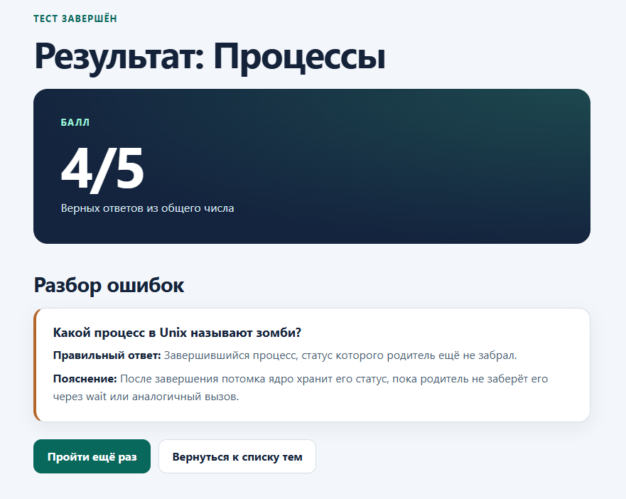

# Отчёт по лабораторной работе на «5»

Базовая версия на «4» сохранена в `master`. SDD оформлен после разработки
базовой версии: [спецификация](docs/spec.md), [план](docs/plan.md),
[задачи](docs/tasks.md).

## Назначение и запуск

Тренажёр помогает подготовиться к экзамену по операционным системам.
Docker Compose запускает `web` с Django 5.2, `db` с PostgreSQL и `valkey`
для кеша. `web` ждёт готовности обеих зависимостей. Учебные данные хранятся
в томе PostgreSQL, список тем с количеством вопросов кешируется на
60 секунд. Адрес: [http://localhost:8001/](http://localhost:8001/).

Запуск в PowerShell из корня проекта:

```powershell
if (-not (Test-Path .env)) { Copy-Item .env.example .env }
docker compose up --build -d
docker compose exec web python manage.py migrate
docker compose exec web python manage.py loaddata demo.json
docker compose exec web python manage.py test
```

Для защиты: по [командам демонстрации из README](README.md#демонстрация-valkey-на-защите)
удалить только ключ списка тем, сделать два запроса к главной и сравнить
TTL и счётчики `GET`/`SET`. Интеграционные тесты из того же раздела
показывают число SQL-запросов к PostgreSQL.

## Прохождение теста

На главной странице показаны темы и количество вопросов. Пользователь выбирает тему, отвечает на вопросы и отправляет форму. Сервер проверяет, что каждый вариант относится к своему вопросу, рассчитывает балл (например, `3/5`) и показывает правильные ответы с пояснениями к ошибкам. Если вопрос пропущен, сообщение появляется рядом с ним, а остальные выбранные ответы сохраняются. Из результата можно вернуться к списку тем.

## Работа в OpenCode и проверка

- Проверили, что MCP-сервер Context7 возвращает документацию Django 5.2 по команде `loaddata`.
- Добавили `AGENTS.md` с правилами проекта и вызвали собственный Skill `quiz-review` для проверки сценариев тренажёра.
- В базовой версии все 16 тестов прошли в отдельном окружении PostgreSQL.

## Выполненные проверки версии на «5»

| Проверка | Фактический результат |
| --- | --- |
| Запуск и данные | На порту 8001 главная вернула HTTP 200, `db` и `valkey` были `healthy`. В отдельном стеке применены миграции и загружены 52 записи из `demo.json`. После пересоздания контейнера PostgreSQL все 10 вопросов остались в томе. |
| Холодный кеш | После удаления ключа `TTL` вернул `-2`. Первый HTTP-запрос добавил один `GET` и один `SET`; TTL стал 60 секунд. |
| Прогретый кеш | Повторный HTTP-запрос вернул тот же список: один дополнительный `GET`, без `SET`; TTL был 59 секунд. Интеграционные тесты с Valkey зафиксировали `1 → 0` SQL-запросов и подтвердили кеширование пустого списка. |
| Тесты Django | Все 18 тестов прошли в отдельном окружении PostgreSQL и Valkey через Docker Compose, включая проверку баллов `0/5` и `5/5`, пустой темы и недопустимых вариантов. |
| Пользовательский сценарий | В Chrome выбраны «Процессы»: пропуск вызвал сообщение рядом с вопросом и сохранил остальные четыре ответа. После исправления получено `3/5`, показаны верные варианты и пояснения к двум ошибкам. Сценарий прошёл на ширинах 1366, 390 и 320 px без горизонтальной прокрутки. Неизвестная тема вернула HTTP 404. |

Мобильную вёрстку проверили в эмуляции Chrome, не на физическом телефоне.

## Результат ручного ревью базовой версии

При прохождении темы «Процессы» тренажёр показал **4 из 5**. Для неверного ответа на вопрос о процессе-зомби отобразились правильный вариант и пояснение.


